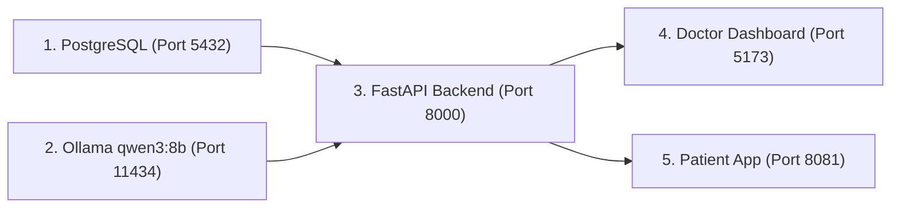

# CarePilot AI — Complete Setup Guide on a Second Laptop (Windows)

This document provides step-by-step, verified setup instructions for continuing development and research of **CarePilot AI** on a new Windows laptop.

---

## A. Project Overview

CarePilot AI is an academic research prototype demonstrating a **Human-in-the-Loop (HITL) Retrieval-Augmented Generation (RAG) Clinical Pipeline for Patient–Doctor Communication**.

### 1. Architectural Safeguards & Research Principles
1. **Safety Invariant I1 (Clinical Guardrail)**: The patient application **NEVER** displays raw AI-generated drafts. Only clinician-approved or clinician-edited responses (`status = 'approved'` / `'delivered'`) are presented to the patient.
2. **Safety Invariant I2 (Patient EHR Scoping)**: 100% of patient EHR queries are strictly filtered by `patient_id`. Zero cross-tenant data leakage is permitted.
3. **Safety Invariant I3 (Firm Red-Flag Emergency Override)**: Inquiries matching any of the 11 clinical emergency categories (chest pain, respiratory distress, stroke indicators, acute hemorrhage, syncope/seizure, anaphylaxis, self-harm, meningitis/sepsis, acute abdomen, sudden severe headache, overdose/poisoning) are immediately diverted to a priority emergency review queue without generating an AI draft.
4. **Citation Boundary Contract**: Every sentence in an AI draft must carry explicit citation tokens (`kb:{doc_id}:chunk{n:04d}` or `ehr:{table}:{stable_id}`) verified against retrieved evidence pools via cross-encoder Natural Language Inference (NLI).
5. **Human Clinician Review (Spec S9 / B5)**: Clinicians review, edit, or reject drafts in a 3-column workspace, logging 12 structured edit categories and Levenshtein edit burden metrics.

### 2. Core Modules
- **FastAPI Backend (`backend/`)**: Core REST API, two-stage retrieval orchestrator, NLI faithfulness validator, and doctor queue management.
- **Doctor Review Dashboard (`doctor-dashboard/`)**: React 18 + Vite desktop workspace with 3-tier urgency queue, interactive citations, and 12-category review logging.
- **Patient Mobile App (`patient-app/`)**: Expo SDK 57 / React Native mobile and web application for patient consultations, records, and approved communication.
- **PostgreSQL Database (`carepilot_v3`)**: 2,330 synthetic Synthea patients, ~2.5 million longitudinal clinical records, LOINC reference ranges, and consultation audit logs.
- **Medical Knowledge Base (`rag_knowledge/`)**: 1,045 medical documents yielding 10,074 chunks dual-indexed in ChromaDB (`carepilot_kb_v5`) and BM25 (`bm25_index_v5.pkl`).
- **Triage Classifiers (`backend/models/`)**: BGE-small embedding backbone with calibrated Logistic Regression for Intent and Urgency triage.
- **Local LLM**: Local inference via Ollama (`qwen3:8b`, Q4_K_M).

---

## B. Repository Transfer & Git Workspace

### 1. Clone the Authoritative Repository
On the second laptop, open Windows PowerShell and run:

```powershell
# Navigate to the target drive (e.g., D:\ or C:\Projects)
Set-Location -Path "D:\"

# Clone the repository
git clone https://github.com/Sarathychandramohan/Carepilot.git CarePilotAI

# Enter the project directory
Set-Location -Path "D:\CarePilotAI"

# Check out the active research branch
git checkout feature/pillar-c-eval

# Verify branch and latest commit
git status
git log -n 3 --oneline
```

### 2. Large Data Bundles (Transferred Separately)
Due to size and binary nature, the following artifacts are transferred via an external USB drive or secure cloud storage bundle (`CarePilot_Transfer_Bundle/`):
- `carepilot_v3_backup.dump` (~60 MB): PostgreSQL compressed database dump.
- `chroma_db.zip` (~140 MB): Compressed ChromaDB vector store directory.
- `bm25_index_v5.pkl` (14.8 MB): Pre-computed BM25 sparse index.
- `backend/.env`: Local configuration file containing database password and paths.

Place these files into the following repository locations:
```powershell
# Copy ChromaDB directory
Expand-Archive -Path "E:\CarePilot_Transfer_Bundle\chroma_db.zip" -DestinationPath "D:\CarePilotAI\rag_knowledge\"

# Copy BM25 Index
Copy-Item "E:\CarePilot_Transfer_Bundle\bm25_index_v5.pkl" -Destination "D:\CarePilotAI\rag_knowledge\"

# Copy Local Environment File
Copy-Item "E:\CarePilot_Transfer_Bundle\.env" -Destination "D:\CarePilotAI\backend\.env"
```

---

## C. Prerequisites

Install the following software on the second laptop:

| Dependency | Minimum Version | Verified Working Version | Installation Guide |
|---|---|---|---|
| **Operating System** | Windows 10 (64-bit) | Windows 11 Pro 64-bit | Standard Windows OS |
| **PowerShell** | PowerShell 5.1+ | PowerShell 7.4+ | Built-in or `winget install Microsoft.PowerShell` |
| **Git** | 2.40+ | 2.47+ | `winget install Git.Git` |
| **Python** | 3.11 – 3.13 | Python 3.13.1 (64-bit) | `winget install Python.Python.3.13` (Check "Add to PATH") |
| **PostgreSQL** | 16.0+ | PostgreSQL 18.0 | `winget install PostgreSQL.PostgreSQL` |
| **Node.js & npm** | Node 20 LTS | Node.js v20.18.0 / npm 10.8+ | `winget install OpenJS.NodeJS.LTS` |
| **Ollama** | 0.3.0+ | 0.4.0+ | Download from https://ollama.com/download |
| **Java (Optional)** | OpenJDK 17 | OpenJDK 17.0.10 | Only required if rebuilding Synthea Java generator |

---

## D. Python Backend Setup

Run all commands from `D:\CarePilotAI`:

### 1. Create and Activate Virtual Environment
```powershell
Set-Location -Path "D:\CarePilotAI"

# Create Python virtual environment
python -m venv .venv

# Activate the virtual environment
.\.venv\Scripts\Activate.ps1
```

*Note: If PowerShell execution policy blocks activation, run `Set-ExecutionPolicy -Scope CurrentUser -ExecutionPolicy RemoteSigned`.*

### 2. Install Python Dependencies
```powershell
pip install --upgrade pip
pip install -r backend/requirements.txt
```

### 3. Configure Local Environment Variables
If you did not copy an existing `backend/.env`, create one from the template:
```powershell
Copy-Item "backend\.env.example" "backend\.env"
```

Edit `backend/.env` with your PostgreSQL password and local paths:
```ini
DB_HOST=localhost
DB_PORT=5432
DB_NAME=carepilot_v3
DB_USER=postgres
DB_PASSWORD=YOUR_STRONG_POSTGRES_PASSWORD

KB_SNAPSHOT_ID=v5
CHROMA_COLLECTION=carepilot_kb_v5
BM25_INDEX_PATH=D:/CarePilotAI/rag_knowledge/bm25_index_v5.pkl
EMBEDDING_MODEL=BAAI/bge-small-en-v1.5

BACKEND_HOST=0.0.0.0
BACKEND_PORT=8000
CORS_ORIGINS=http://localhost:5173,http://localhost:8081
```

---

## E. PostgreSQL Database Restoration

The database `carepilot_v3` holds all longitudinal patient EHR tables.

### 1. Create the Database
Open PowerShell and create the target database:
```powershell
# Ensure PostgreSQL bin directory is in PATH or use full path
$env:PATH += ";C:\Program Files\PostgreSQL\18\bin"

# Create carepilot_v3 database
createdb -U postgres -h localhost -p 5432 carepilot_v3
```

### 2. Restore Database Dump
Restore the provided snapshot:
```powershell
pg_restore -U postgres -h localhost -p 5432 -d carepilot_v3 -v "E:\CarePilot_Transfer_Bundle\carepilot_v3_backup.dump"
```

### 3. Verify Database Counts
Run the verification check:
```powershell
.\.venv\Scripts\python -c "
from backend.app.db.session import SessionLocal
from sqlalchemy import text

db = SessionLocal()
try:
    pts = db.execute(text('SELECT count(*) FROM patients;')).scalar()
    labs = db.execute(text('SELECT count(*) FROM lab_results;')).scalar()
    rxs = db.execute(text('SELECT count(*) FROM prescriptions;')).scalar()
    conds = db.execute(text('SELECT count(*) FROM conditions;')).scalar()
    print(f'Verification Successful: {pts} patients, {labs} labs, {rxs} prescriptions, {conds} conditions.')
finally:
    db.close()
"
```
**Expected Counts**:
- `patients`: **2,330** (2,030 alive / 300 deceased)
- `encounters`: ~137,570
- `lab_results`: ~1,731,561
- `prescriptions`: ~115,655
- `conditions`: ~84,083

---

## F. Knowledge Base, ChromaDB & Ollama Setup

### 1. Verify ChromaDB & BM25 Index
Confirm that `rag_knowledge/chroma_db` and `rag_knowledge/bm25_index_v5.pkl` exist:
```powershell
Test-Path "D:\CarePilotAI\rag_knowledge\chroma_db"
Test-Path "D:\CarePilotAI\rag_knowledge\bm25_index_v5.pkl"
```

Verify retrieval operation with the inspection script:
```powershell
.\.venv\Scripts\python -m backend.scripts.inspect_pillar_a kb
```

### 2. Setup Ollama and Qwen3-8B
CarePilot AI uses local inference (`qwen3:8b`) without cloud dependencies:
```powershell
# Start Ollama service (runs in background or system tray)
ollama serve

# In a separate terminal, download the Qwen3-8B model
ollama pull qwen3:8b

# Test inference
ollama run qwen3:8b "Hello, CarePilot AI"
```

---

## G. Frontend Setup

### 1. Doctor Dashboard (React 18 + Vite)
```powershell
Set-Location -Path "D:\CarePilotAI\doctor-dashboard"

# Install node dependencies
npm install

# Start Vite development server
npm run dev
```
- **Local URL**: `http://localhost:5173`
- **Features**: 3-column clinician review queue, interactive source citations, 12-category review panel.

### 2. Patient Application (React Native / Expo SDK 57)
```powershell
Set-Location -Path "D:\CarePilotAI\patient-app"

# Install node dependencies
npm install

# Start web interface
npx expo start --web
```
- **Local URL**: `http://localhost:8081`
- **Features**: Patient portal, consultation history, approved responses only.

---

## H. Starting the Complete Application

To run the entire CarePilot AI stack, start services in the following order:



1. **Terminal 1 — PostgreSQL**: Running automatically as a Windows service.
2. **Terminal 2 — Ollama**:
   ```powershell
   ollama serve
   ```
3. **Terminal 3 — FastAPI Backend**:
   ```powershell
   Set-Location -Path "D:\CarePilotAI"
   .\.venv\Scripts\Activate.ps1
   uvicorn backend.app.main:app --host 127.0.0.1 --port 8000 --reload
   ```
   *Health Check*: Open `http://localhost:8000/docs` in your browser.
4. **Terminal 4 — Doctor Dashboard**:
   ```powershell
   Set-Location -Path "D:\CarePilotAI\doctor-dashboard"
   npm run dev
   ```
5. **Terminal 5 — Patient App**:
   ```powershell
   Set-Location -Path "D:\CarePilotAI\patient-app"
   npx expo start --web
   ```

---

## I. Verification Checklist & Test Execution

Run the backend verification suite from `D:\CarePilotAI`:

```powershell
Set-Location -Path "D:\CarePilotAI"
.\.venv\Scripts\Activate.ps1

# 1. Test 11 Clinical Red-Flag Categories (88 tests)
python -m pytest backend/tests/test_redflag_11_categories.py

# 2. Test EHR Fact Extraction & Grounding Accuracy (43 tests)
python -m pytest backend/tests/test_ehr_fact_accuracy.py

# 3. Test Pipeline Skip Reason & Gate Logic (7 tests)
python -m pytest backend/tests/test_skip_reasons.py

# 4. Test Evaluation Harness Statistics & Metrics Layer (16 tests)
python -m pytest backend/tests/test_eval_harness.py

# 5. Run Evaluation Harness Dry-Run (Fast Wiring Test)
python -m backend.eval.run --config full --split gold-dev --seed 42 --subset 2 --dry-run
```

All unit tests and pre-flight checks should pass 100%.

---

## J. Troubleshooting Common Issues

| Symptom | Root Cause | Solution |
|---|---|---|
| `psycopg.OperationalError: connection to 127.0.0.1:5432 failed` | PostgreSQL service not running or port blocked | Start PostgreSQL service in `services.msc` or run `net start postgresql-x64-18`. |
| `ERROR GUARD: DATABASE_URL points to 'carepilot_db'! Target MUST be 'carepilot_v3'` | Incorrect DB name in `backend/.env` | Change `DB_NAME=carepilot_v3` or set `DATABASE_URL=postgresql://postgres:<pw>@localhost:5432/carepilot_v3`. |
| `Ollama server not reachable at http://127.0.0.1:11434` | Ollama service not started | Open terminal and run `ollama serve`. Verify `ollama list` shows `qwen3:8b`. |
| `FileNotFoundError: Intent model not found at .../backend/models/intent_classifier.pkl` | Classifiers not yet trained or copied | Run `python -m backend.scripts.train_classifiers` to generate both models. |
| `FileNotFoundError: bm25_index_v5.pkl` | BM25 index missing from transfer bundle | Place `bm25_index_v5.pkl` in `rag_knowledge/` or run `python -m backend.scripts.rebuild_bm25_from_chroma`. |
| `TypeError: '<' not supported between instances of 'int' and 'MagicMock'` | Unit test run without real DB or improper mock | Normal in unit test mocking; ensure real runs use active PostgreSQL connection. |
| `Metro / Expo Error: Watchman / Node compatibility` | Node version mismatch | Use Node 20 LTS. Clear cache with `npx expo start -c --web`. |

---

## K. Future Development & Contribution Workflow

To keep research and implementation clean:

1. **Always branch off `feature/pillar-c-eval`**:
   ```powershell
   git checkout -b feature/your-subfeature-name
   ```
2. **Never commit secrets**:
   Verify that `git status` never stages `backend/.env` or files containing passwords.
3. **Never commit large binaries**:
   Keep `.dump`, `.gguf`, `chroma_db/`, and `bm25_index_*.pkl` outside of Git.
4. **Run the test suite before pushing**:
   ```powershell
   python -m pytest
   ```
5. **Push your feature branch cleanly**:
   ```powershell
   git push origin feature/your-subfeature-name
   ```
