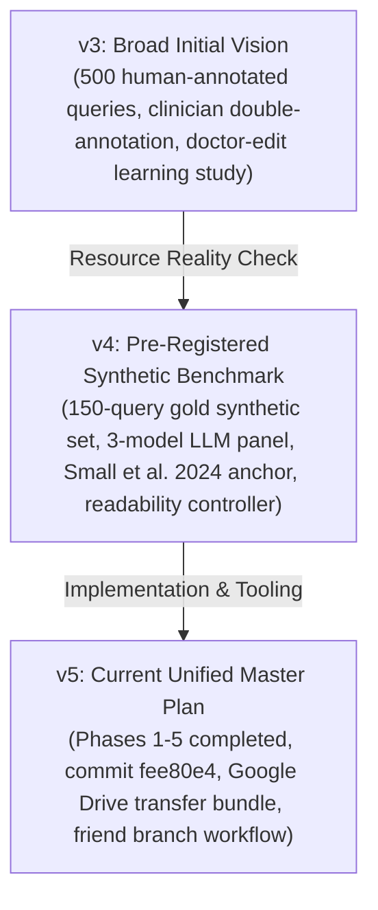
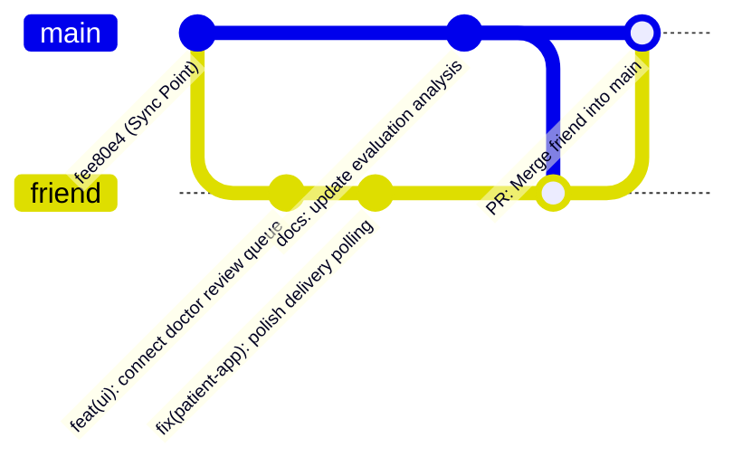

# CarePilot AI — Master Build, Research Plan, and Collaborator Guide (v5)

**Document Version:** v5 (Consolidated Architecture, Research Protocol, and Collaborator Onboarding)  
**Date Updated:** 17 October 2026  
**Project Root:** `D:\CarePilotAI`  
**Git Remote:** `https://github.com/Sarathychandramohan/Carepilot.git`  
**Active Collaboration Branches:** `main` (Personal development) & `friend` (Collaborator development)  
**Primary Database:** PostgreSQL 18 (`carepilot_v3`)  
**Project Type:** B.E. Final-Year Research Prototype & Capstone (Synthetic EHR Data Only)  

---

## 0. Executive Summary & Quick Start for Collaborators

CarePilot AI is a **Human-in-the-Loop (HITL) Clinical Retrieval-Augmented Generation (RAG) System** designed for patient–doctor in-basket communication. 

When a patient message enters the system:
1. **Triage:** Intent and urgency are classified; deterministic red-flag emergency rules run.
2. **Patient Evidence:** Longitudinal facts are retrieved server-side from the patient's synthetic Synthea Electronic Health Record (EHR).
3. **Public Knowledge:** Relevant medical guidance is retrieved from a dual-index knowledge base (ChromaDB dense vectors + BM25 sparse lexical).
4. **Draft Generation:** An open-weight local model (**Ollama `qwen3:8b`**) generates a structured clinical response with explicit inline citations.
5. **Quality & Safety Gates:** Readability control (target grade $\le 8$), two-way NLI factual equivalence, citation validity, and contradiction checks execute.
6. **Mandatory Doctor Review:** Every response remains blocked until an authenticated clinician approves or edits it in the Doctor Dashboard.

> [!IMPORTANT]
> ### Where the Project Stands Today (Status at Commit `fee80e4`):
> - **Phases 1 through 5 are already implemented and tested.** Database migrations `002`–`004`, the 2,330-patient PostgreSQL schema, Knowledge Base v5 (10,074 chunks), the BGE-small intent/urgency classifiers, the 11-category emergency rules, the evaluation harness, and frontend API clients are already built and verified in the repository.
> - **Your Quickstart Manual:** Before diving into the academic sections of this plan, read and follow **[`docs/FRIEND_SETUP_GUIDE.md`](file:///D:/CarePilotAI/docs/FRIEND_SETUP_GUIDE.md)** to clone your branch (`friend`), restore the database, and launch the dev servers in 10 minutes.

---

## 1. Project Invariants and Safety Boundaries

1. **Synthetic Data Only:** Uses Synthea-generated longitudinal records and curated public medical sources (MedlinePlus, CDC, FDA, NIDDK). No real Protected Health Information (PHI) is ever imported.
2. **Safety Invariant I1 (Mandatory Doctor Approval):** The patient app **NEVER** displays raw AI-generated drafts. Only clinician-approved or clinician-edited responses (`status = 'approved'` / `'delivered'`) reach the patient.
3. **Safety Invariant I2 (Patient Data Isolation):** 100% of patient EHR queries are strictly scoped in SQL by `patient_id`. Zero cross-tenant data leakage is permitted.
4. **Safety Invariant I3 (Firm Red-Flag Emergency Override):** Inquiries matching any of the 11 clinical emergency categories (chest pain, acute hemorrhage, stroke indicators, anaphylaxis, etc.) trigger immediate diversion to an urgent clinical queue without generating an AI draft.
5. **No Autonomous Diagnosis or Treatment:** CarePilot AI assists clinicians; it never replaces licensed clinical judgement.
6. **Protected Benchmark Data:** Collaborators must never edit or overwrite `data/queries/gold_scripted_candidate.jsonl` or `data/queries/silver.jsonl`.
7. **Git Collaboration Rule:** Collaborators commit and push strictly to branch **`friend`** and submit Pull Requests into **`main`**. Neither developer ever force-pushes or commits directly to the other's branch.

---

## 2. Research Evolution: From v3 to v4 and v5

The project has evolved through three major iterations to ensure scientific rigor and real-world feasibility:



### Summary of Adjustments
| Dimension | v3 Plan | v4 / v5 Updated Plan | Scientific Rationale |
|---|---|---|---|
| **Gold Benchmark** | 500 human clinician-annotated queries | **150 synthetic EHR-grounded queries** (60 pilot + 90 new) | Clinician raters were not accessible; 150 panel-labelled queries provide a transparent, reproducible benchmark without pretending LLM labels are human gold. |
| **Labelling Protocol** | Clinician Cohen's Kappa | **Blind 3-model LLM Panel** (ChatGPT, Gemini, Claude) with Fleiss' Kappa | Uses standardized rubrics from public emergency guidance with conservative any-vote-urgent rules. |
| **Research Anchor** | General RAG literature | **Small et al. (2024)**, *JAMA Network Open* | Anchors CarePilot AI directly to Small et al.'s finding that LLM clinical drafts are often too complex, too long, and difficult for low-health-literacy patients. |
| **Readability** | Uncontrolled generation | **Readability Controller (B5b)** | Actively simplifies vocabulary to target Flesch–Kincaid grade $\le 8$ while enforcing two-way NLI factual preservation. |
| **Missing Context** | Silent pipeline skip | **Clarify-Instead-of-Skip** | When clinical context is missing, the system generates a concise clarification request instead of dropping the query. |
| **Doctor Edit Research** | Claimed edit reduction over time | **Instrumented Logging Only** | Captures edit distances, diffs, and timestamps for future study, without making unsubstantiated efficacy claims. |

---

## 3. System Architecture & Component Inventory

CarePilot AI is structured into four interconnected pillars:

```
[Patient In-Basket Query]
         │
         ▼
┌────────────────────────────────────────────────────────┐
│  PILLAR B: PIPELINE ORCHESTRATOR                      │
│                                                        │
│  B1. Triage: Intent Classifier (5 classes)            │
│              Urgency Classifier (routine/soon/urgent)  │
│  B2. Emergency Override: 11 Red-Flag Categories       │
│  B3. EHR Retrieval: Patient-scoped SQL + D17 Checks    │
│  B4. KB Retrieval: ChromaDB (Dense) + BM25 (Sparse)   │
│  B5. Local Generation: Ollama Qwen3-8B (Citations)    │
│  B5b. Readability Controller: Grade <= 8 rewrite       │
│  B6. Validation Gates: Citation, NLI, Contradiction   │
│  B6b. Claim Verification: Atomic evidence links        │
└───────────────────────────────────┬────────────────────┘
                                    │
                                    ▼
┌────────────────────────────────────────────────────────┐
│  PILLAR D: CLINICIAN REVIEW & DELIVERY                │
│                                                        │
│  Doctor Dashboard (React + Vite, Port 5173):           │
│  - 3-column clinician workspace                        │
│  - Urgency queue, EHR evidence & KB citation panels    │
│  - Approve, edit, reject, or request clarification     │
│                                                        │
│  Patient App (React Native / Expo SDK 57, Port 8081):  │
│  - Delivered response only after doctor approval (I1)  │
└────────────────────────────────────────────────────────┘
```

### Verified Subsystem Specifications
- **Operating Environment:** Windows 10/11 64-bit, Python 3.13 (`.venv`), Node 20 LTS.
- **Relational EHR (Pillar A):** PostgreSQL 18 database `carepilot_v3` (2,330 patients, ~2.5 million rows across 9 normalized tables).
- **Embeddings:** `BAAI/bge-small-en-v1.5` (384-dimensional dense vectors).
- **Vector Store:** ChromaDB collection `carepilot_kb_v5` (10,074 chunks from 1,045 public medical documents).
- **Sparse Index:** BM25Okapi index `rag_knowledge/bm25_index_v5.pkl`.
- **Local LLM Engine:** Ollama running `qwen3:8b` (Q4_K_M 4-bit GGUF, 8B parameters, temperature 0.0, seed 42).
- **NLI Cross-Encoder:** `cross-encoder/nli-deberta-v3-small`.

---

## 4. Research Questions and Hypotheses (Pillar C)

- **RQ1 (EHR Grounding):** Does adding patient-scoped EHR context improve coverage of patient-specific clinical facts compared with a `no_ehr` ablation without increasing unsupported patient claims?
- **RQ2 (Urgency & Safety Triage):** Does the independent urgency classifier combined with the deterministic 11-category red-flag override prevent dangerous under-triage compared with LLM-only classification, especially on keyword-free urgent queries?
- **RQ3 (Doctor Edit Instrumentation):** Can doctor review, edits, and rejections be cleanly instrumented with structured diffs and timestamps without relying on clinical efficacy claims?
- **RQ4 (Readability vs. Faithfulness):** Can an automated post-generation readability controller reduce reading grade level (FK grade $\le 8$) and message length without sacrificing evidence support or clinical completeness?

---

## 5. Google Drive External Data Bundle (`CarePilotAI_Transfer`)

To keep Git fast and prevent exposing sensitive credentials, large runtime artifacts are distributed via the **`CarePilotAI_Transfer`** folder on Google Drive.

```
CarePilotAI_Transfer/
├── 01_DATABASE/
│   └── carepilot_v3_backup.dump       ──> Restore into PostgreSQL 'carepilot_v3' (62.3 MB)
├── 02_RAG_ARTIFACTS/
│   ├── chroma_db.zip                 ──> Unpack into rag_knowledge/ (227.4 MB)
│   └── bm25_index_v5.pkl             ──> Copy into rag_knowledge/ (15.5 MB)
├── 03_SYNTHEA_ETL/
│   └── carepilot_data/               ──> Reference custom ETL scripts & schemas
├── 04_CONFIG_AND_ENV/
│   └── .env                          ──> Local database credentials & paths template
├── 05_RESEARCH_DATA/
│   ├── patient_picker_sheet.csv      ──> Reference clinical facts across 2,030 alive patients
│   ├── patient_picker_shortlist.csv  ──> Shortlisted study cohort
│   └── working_changes_post_c_audit.patch
├── 06_LLM_CONFIG/
│   └── README_OLLAMA.md              ──> Ollama setup & offline model instructions
├── CHECKSUMS_SHA256.txt              ──> Cryptographic SHA-256 verification hashes
├── SETUP_ON_ANOTHER_LAPTOP.md
└── TRANSFER_MANIFEST.md
```

### Destination Mapping Commands
Assuming the folder is placed at `D:\CarePilotAI_Transfer`:
```powershell
# In D:\CarePilotAI:
Expand-Archive -Path "D:\CarePilotAI_Transfer\02_RAG_ARTIFACTS\chroma_db.zip" -DestinationPath "rag_knowledge\" -Force
Copy-Item "D:\CarePilotAI_Transfer\02_RAG_ARTIFACTS\bm25_index_v5.pkl" -Destination "rag_knowledge\" -Force
Copy-Item "D:\CarePilotAI_Transfer\04_CONFIG_AND_ENV\.env" -Destination "backend\.env" -Force
```

---

## 6. Database Restoration on Collaborator Machine

1. Ensure PostgreSQL 18 is installed (`winget install PostgreSQL.PostgreSQL`).
2. Open PowerShell and run:
   ```powershell
   $env:PATH += ";C:\Program Files\PostgreSQL\18\bin"
   createdb -U postgres -h localhost -p 5432 carepilot_v3
   pg_restore -U postgres -h localhost -p 5432 -d carepilot_v3 -v "D:\CarePilotAI_Transfer\01_DATABASE\carepilot_v3_backup.dump"
   ```
3. Update `backend/.env` with your local PostgreSQL password:
   ```ini
   DB_PASSWORD=YOUR_LOCAL_POSTGRES_PASSWORD
   ```
4. Verify record counts:
   ```powershell
   .\.venv\Scripts\python -c "from backend.app.db.session import SessionLocal; from sqlalchemy import text; db=SessionLocal(); print('Patients:', db.execute(text('SELECT count(*) FROM patients')).scalar()); db.close()"
   ```
   *(Must equal **2,330** patients).*

---

## 7. Starting the Complete Application Stack

Start services in separate PowerShell windows:

```powershell
# 1. Start Ollama local LLM
ollama serve

# 2. In repository root D:\CarePilotAI: Activate Python venv and launch backend
.\.venv\Scripts\Activate.ps1
uvicorn backend.app.main:app --host 127.0.0.1 --port 8000 --reload
# API Docs: http://localhost:8000/docs

# 3. In doctor-dashboard/
npm run dev
# Dashboard UI: http://localhost:5173

# 4. In patient-app/
npx expo start --web
# Patient Portal: http://localhost:8081
```

---

## 8. Collaborator Responsibilities & Active Work Scope (Pillar D)

With Phases 1–5 and the core pipeline locked and evaluated, the collaborator on branch **`friend`** focuses on **Pillar D: UI/API Integration and Clinical Workflow Demonstration**:

1. **Doctor Review Workspace (`doctor-dashboard`):**
   - Enhance the 3-column review UI: queue column, draft review column, and live EHR/KB evidence inspection column.
   - Connect queue filtering by urgency level (`routine`, `soon`, `urgent`) and ensure prominent display of emergency red-flag banners.
   - Ensure clinician edit diff logging captures edit categories and approval state.
2. **Patient Consultation Portal (`patient-app`):**
   - Connect patient query submission to `POST /api/consult/submit`.
   - Verify that patient consultation status polling correctly reflects `awaiting_doctor` and only renders the draft once marked `delivered`.
   - Display the mandatory synthetic data disclaimer banner prominently.
3. **End-to-End Integration Testing:**
   - Execute scripted clinical flows: (a) Urgent emergency inquiry diversion, (b) Routine medication consultation approval, (c) Missing-context clarification, and (d) Clinician draft edit.
   - Run existing unit test suites before pushing:
     ```powershell
     python -m pytest backend/tests/test_redflag_11_categories.py
     python -m pytest backend/tests/test_ehr_fact_accuracy.py
     python -m pytest backend/tests/test_skip_reasons.py
     python -m pytest backend/tests/test_eval_provenance.py
     ```

---

## 9. Git Collaboration Protocol



1. **Dedicated Branches:**
   - Sarathy works on **`main`**.
   - Collaborator works on **`friend`**.
2. **Pushing Changes:**
   ```powershell
   git add <modified-source-files>
   git commit -m "feat(scope): descriptive explanation of changes"
   git push origin friend
   ```
3. **Integration via Pull Request:**
   - Collaborator opens a PR on GitHub from `friend` into `main`.
   - Changes are reviewed and merged without force-pushing.
4. **Keeping Clean:**
   - Always run `git status --short` before committing.
   - Never stage `backend/.env`, `*.dump`, `rag_knowledge/chroma_db/`, `rag_knowledge/*.pkl`, `.venv/`, or `node_modules/`.

---

## 10. Research Reporting & Claim Boundaries

When presenting or documenting this project:

### Allowed Claims (Supported by Evidence)
- Demonstrates a reproducible, synthetic-EHR-grounded clinical RAG pipeline.
- Implements transparent component-level ablations (`full`, `no_ehr`, `no_classifier`, `no_readability`).
- Evaluates intent and urgency triage on a declared synthetic, LLM-panel-labelled benchmark.
- Evaluates automated sentence-level citation validity and cross-encoder NLI entailment.
- Measures trade-offs between readability simplification, evidence faithfulness, and message completeness.

### Prohibited Claims (Do Not Make)
- Do **not** claim real-world clinical safety or patient health benefits.
- Do **not** claim reduced physician burnout, time savings, or clinician preference.
- Do **not** claim superiority over commercial EHR tools or published clinical trials.
- Do **not** equate automated NLI scores or LLM-panel votes with licensed medical expert consensus.
